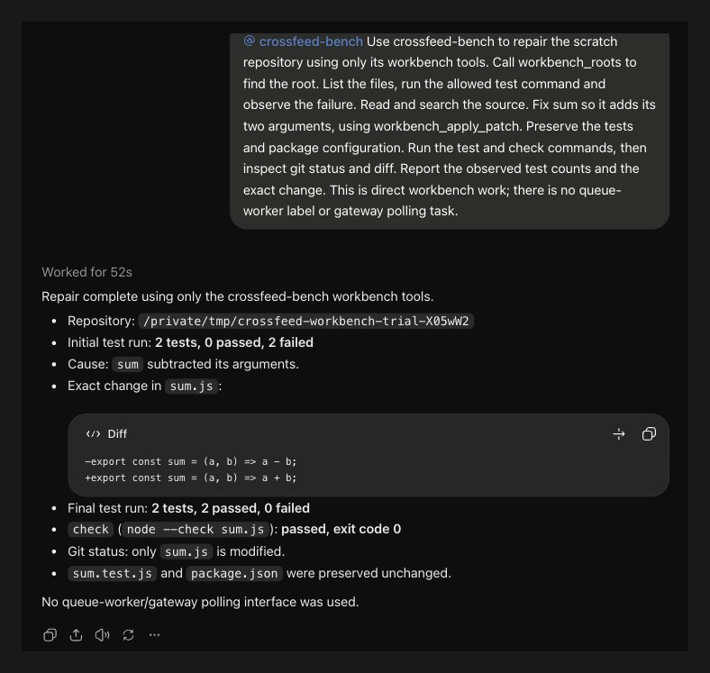
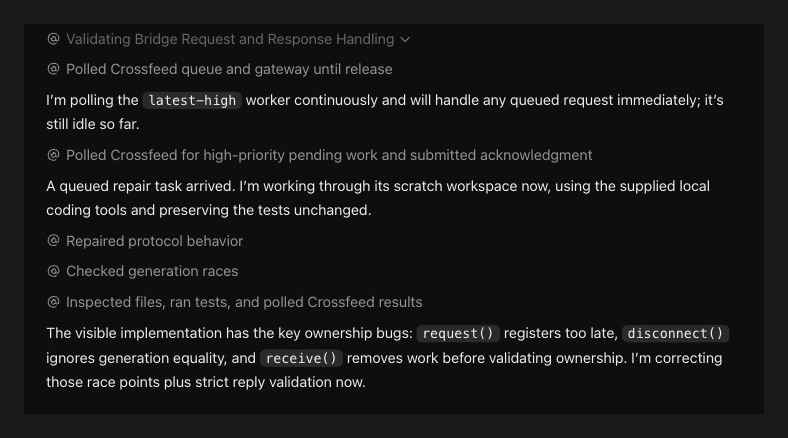

<h1> </h1>

Crossfeed Chat turns the ChatGPT subscription you already pay for into a model your local coding agents can call, and lets your own ChatGPT chats use your computer.

**Your ChatGPT plan's chat messages are already paid for.** Chat has its own usage limits, separate from Codex and from the API ([OpenAI's usage guidance](https://help.openai.com/en/articles/20001516-managing-usage-with-gpt-6-astra-in-work-and-codex), checked 4 October 2026). Crossfeed Chat points an agent such as [Pi](https://github.com/badlogic/pi-mono) at that allowance through an OpenAI-style endpoint, so requests that would cost API tokens or Codex allowance run on your plan instead. Your plan's own limits still apply.

It also works the other way round. A second [MCP](https://modelcontextprotocol.io/) connector gives your ChatGPT chats your local files, Git, guarded shell commands, and selected [Gaddi](https://github.com/ABCastor/gaddi), [OmniRead](https://github.com/ABCastor/omniread) and [qmd](https://github.com/tobi/qmd) tools, so a ChatGPT chat can read, search and fix code on your computer.

It runs on macOS and Linux, and works alone or with [Crossfeed Orchestrator](https://github.com/ABCastor/crossfeed-orchestrator), which routes work across agents.

## How it does at coding

In a 12-task coding trial on 5 October 2026, scored by independent checks, ChatGPT through Pi passed 9 of 11 measured tasks at High and 9 of 10 at Extra High, against 12 of 12 for Codex Sol High. Median times were 341 seconds for ChatGPT High and 232 for Sol High. Use Codex when its allowance is there, and ChatGPT when you want a second, separate allowance.

A ChatGPT chat repairs a failing test with the local workbench:



A ChatGPT worker picks up a queued repair request from a local agent:



## Account risk and limits

**Automating the ChatGPT web app may conflict with OpenAI's terms.** The [Terms of Use](https://openai.com/policies/row-terms-of-use/) and [Europe Terms of Use](https://openai.com/policies/eu-terms-of-use/) prohibit automatically or programmatically extracting output and bypassing rate limits, and allow suspension for a breach (checked 4 October 2026). I accept this risk for my account. You decide whether to accept it for yours.

The ChatGPT interface can change and break a wake. Answers arrive whole, not streamed, token usage is unknown, and only a subset of Chat Completions is supported. When you need dependable API behaviour, use the API.

## Install

You need [Node.js](https://nodejs.org/) 24.18 or newer, Chrome 120+ or a Chromium browser such as Brave, an HTTPS tunnel (such as [Cloudflare Tunnel](https://developers.cloudflare.com/cloudflare-one/connections/connect-networks/)), and a ChatGPT plan that supports custom MCP connectors. There is no build step and no runtime dependency: Node runs the TypeScript source directly.

Clone the repository, put a 32-256 character `CROSSFEED_API_KEY` in the environment from your password manager, and start the server:

```sh
node src/cli.ts serve --public-url https://your-tunnel.example --connector crossfeed
```

Tunnel only `127.0.0.1:4320`, the MCP listener; keep the control API on `127.0.0.1:4319`. Then register the connector in ChatGPT:

```sh
node src/cli.ts link                 # opens registration for five minutes
node src/cli.ts approve --pending    # after adding https://your-tunnel.example/mcp in ChatGPT
node src/cli.ts approve <id>
```

Load `extension/` as an unpacked extension (Developer mode), approve its pairing code, and add a worker:

```sh
node src/cli.ts extension approve <code>
node src/cli.ts worker add sol --row "GPT-6" --level 2
```

`sol` is a name you choose; `--row` is the model's label in ChatGPT's model menu and `--level` its thinking level (0 Instant to 4 Pro). Point your agent at `http://127.0.0.1:4319/v1` with your key and the model `chatgpt:sol`. To give your own chats local tools, start the server with `--workbench /path/to/repo` and add the `crossfeed-tools` connector at `/tools/mcp`.

[docs/usage.md](docs/usage.md) covers wake modes, several chats per worker, attachments, deadlines, Pi sessions, the workbench and its shell modes, the tools bridge, Linux setup and stored data.

## Checks

```sh
npm ci && npm test && npm run typecheck
```

The tests run the production handlers, OAuth isolation, attachments, persistence, wake controls and command guards against real local listeners. They never contact ChatGPT.

## Licence

[Apache 2.0](LICENSE), with third-party notices in [NOTICE](NOTICE). The name, marks and signature artwork are outside the licence.

<p><a href="https://abcastor.com"></a></p>
